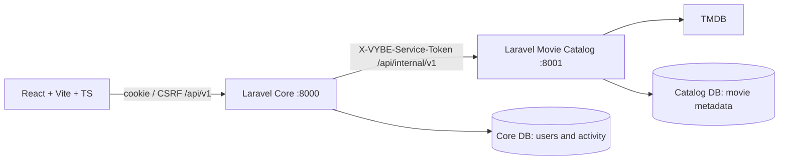

# VYBE — AI Agent and Teammate Engineering Playbook

> Applies to **Codex, Claude Code, ChatGPT, and human contributors**. Read with the repository root [`AGENTS.md`](../AGENTS.md), [`CLAUDE.md`](../CLAUDE.md), and [`PROJECT_ROADMAP.md`](../PROJECT_ROADMAP.md).  
> Baseline checked: remote `dev` at `26d66438729c` on 2026-11-21. **Always verify the current checkout**; no document overrides actual source.

## 0. Agent startup: do this *before proposing or editing code*

1. **Read** root `AGENTS.md`, this playbook, `PROJECT_ROADMAP.md`, then the relevant nested `AGENTS.md` (`backend/`, `frontend/`, `services/movie-catalog/`). Claude additionally reads `CLAUDE.md`.
2. Run `git status -sb`, `git branch -vv`, `git log -5 --oneline`, and `git remote -v`. Determine the *actual* branch, whether changes are uncommitted, and whether its base contains the needed merged dependencies. **Do not assume** `main == dev`, a proposed PR is merged, or a feature branch has not already been created.
3. Inspect the exact feature code/routes/models/DTOs/hooks/tests plus the relevant documentation. Search for existing implementation before adding classes, tables, packages, endpoints or CSS. The legacy checklists may be stale; cite the current implementation as evidence.
4. Read architecture and contracts in this order: [`system-overview.md`](architecture/system-overview.md) **for boundaries, not current feature status**, [`backend.md`](architecture/backend.md) / [`frontend.md`](architecture/frontend.md), [`schema.md`](database/schema.md), [`contracts.md`](api/contracts.md), relevant M2/M3/Discover/FYP contracts, [`design-system.md`](design/design-system.md), and the latest feature report.
5. State a **small implementation plan**: touched components; public/private data boundaries; API/DB changes; file ownership; tests; performance; external-provider limitations. For a new social feature, first agree M4.0 visibility policy and update documentation.
6. Make a focused patch. Update tests, contracts and roadmap together. **Do not commit, switch branches, push, merge, reset, or run destructive migrations without direct authorization.**
7. Before declaring done, run the relevant checks and inspect the rendered UI if modified. Report exactly what ran, what was skipped, evidence, and unresolved limitations.

**Minimal initial read order per task**:

| Work | Read first (after root docs) |
|---|---|
| Core security/API/data | `backend/AGENTS.md`, `docs/architecture/backend.md`, `docs/database/schema.md`, `backend/routes/api.php`, related Requests/Models/Services/tests |
| Catalog/TMDB/candidate | `services/movie-catalog/AGENTS.md`, `docs/api/movie-discovery.md`, `docs/api/recommendations.md`, `services/movie-catalog/routes/api.php`, `MovieService`, `TmdbClient`, feature tests |
| React/UI | `frontend/AGENTS.md`, `docs/architecture/frontend.md`, `docs/design/design-system.md`, `frontend/src/App.tsx`, `frontend/src/layouts/AppLayout.tsx`, matching `src/features/*` and tests |
| Firebase auth/admin | `docs/development/firebase-final-acceptance.md`, `docs/architecture/authentication.md`, `docs/development/firebase-phase-2*.md`, actual auth middleware and tests |
| Social (next) | `PROJECT_ROADMAP.md` M4, `docs/api/milestone-2-contracts.md` (existing private collections), `backend/app/Models/{User,Collection,Review}.php`, current profile/collections React modules |
| Movie Night | `PROJECT_ROADMAP.md` M5, routes/permissions, Movie Catalog batch summaries, existing Library/movie UI |
| Provider integrations | `PROJECT_ROADMAP.md` M6 and existing API clients, secrets/config and caching strategy; confirm provider and user consent before coding |
| Admin completion | `PROJECT_ROADMAP.md` M7, `docs/api/milestone-3-contracts.md`, `ModerationController`, `AdminUserController`, `frontend/src/features/admin/` |

## 1. Non-negotiable service boundaries



**Frontend:** browser communicates *only* with Core. No direct TMDB or Catalog calls, no internal tokens, no client-stored auth tokens. Use existing `frontend/src/lib/api/client.ts`, React Router, TanStack Query, credentialed Axios, auth/session hooks and shared UI.

**Core (`backend/`):** source of truth for user identity (Firebase UID mapping + Laravel sessions), profile, personal library, Favorites, collections, watched, ratings, reviews, reports, admin, user graph, event/voting data, and recommendation ranking. User-specific access control and private caching remain here. It cannot query Catalog's database or call TMDB directly.

**Catalog (`services/movie-catalog/`):** source of truth for TMDB client/secrets, normalized movie metadata/credits, ordered list caches and shared recommendation candidate retrieval. No Core user IDs, authentication sessions, user lists or preferences. Internal endpoints are authenticated via server-only token. No cross-service Eloquent models, joins, FK or direct DB connections.

For new movie-centric social/analytics features, **store TMDB IDs in Core** and retrieve movie info through a **bounded Catalog batch request**. Catalog never receives a personal feed or user ID. On cache misses, follow existing provider fallback/503 policy rather than silently faking data.

**Database engine:** historical documentation refers to MySQL; PostgreSQL compatibility and Neon work were merged later. Inspect the *current* `.env.example`, actual environment/CI and migrations before making engine-specific changes. Never assume live Neon credentials/data migration or that an in-memory SQLite green run proves PostgreSQL production behavior.

## 2. Authentication, authorization, security and privacy

- Identity may be established by Firebase (password/Google/GitHub) and mapped to one Core SQL user, with a Laravel Sanctum **stateful session** for SPA requests. Never implement a parallel JWT/localStorage login flow. Read current config and authentication docs before editing.
- Use existing `EnsureAccountAccess`, `EnsureActiveAccount`, `EnsureVerifiedAccount`, role policies/middleware and resource projections; verify actual route grouping. **Never use a client-supplied user ID to select the authenticated owner.**
- Use FormRequests/typed validation, allowlists, safe DTOs and error envelopes. Preserve CSRF, cookie security, rate limits, session invalidation and 401/403/404/409/419/422/429/503 behavior.
- In public social endpoints, return only explicitly allowed profile fields. No email, UID, private bio/metadata by accident, invite tokens, sessions, auth provider details, or raw preference profile. Enforce visibility in SQL and serialization (not a React-only hide).
- Migrating existing private collections/activity to social sharing must be **private by default** until an explicit user choice is implemented. Prevent hidden/deleted items leaking via counts, activity feeds, cache keys or related resource previews. Define block/restrict/deactivate effects before adding follows or invites.
- Preserve review spoofing/spoiler handling, admin action audit, moderation visibility and retention rules. Hard deletion is a pending product decision; don't add a destructive route casually.
- The internal service token, Firebase admin credentials, mail keys, TMDB tokens and provider secrets must not enter `VITE_*`, Git history, exception bodies or logs.
- Add tests for cross-user access, stale authorization, replay/concurrency, deleted/hidden content and caching across logout/account switch.

## 3. API, data and performance contracts

- New browser endpoints use existing Core `/api/v1/...` patterns; Catalog uses `/api/internal/v1/...` and internal token guard. **Add static routes before greedy `/{tmdb_id}` routes.**
- Follow project conventions: route → controller → FormRequest → service → Eloquent/HTTP → Resource, with no abstract repository layer absent a real need. Reuse normalization, clients and typed React DTOs.
- Keep service request budgets and partial failure behavior explicit. Reuse Catalog list/Discover caching, batch summaries, detail freshness and stale fallback; never make N+1 per-movie detail/credits requests to populate a grid.
- Be precise about semantics: TMDB ratings ≠ VYBE community ratings; Trending is a bounded provider pool, not global Discover; Upcoming dates depend on provider policy; unavailable creator metadata is *missing*, not negative evidence.
- Add indexes supporting new `user_id`/`follower_id`/event scope before introducing large feeds. Unique constraints must enforce idempotency and prevent duplicate follows/votes. For social feed, paginate at SQL level; use bulk Catalog lookups for posters/titles.
- Watchlist/ratings/collection mutations must keep personalized `For You` exclusions current. Never introduce shared public caches of personalized payloads or stale visibility decisions.
- Preserve query cancellation, stale handling and one network request per bounded page as much as possible. Measure actual total/DB/provider timings when changing performance-sensitive code; fake HTTP benchmarks are *not* real provider latency.

**Existing feature API references:**

| Capability | Contract / code to inspect |
|---|---|
| Browser movie listing/search/discover | `docs/api/contracts.md`, `docs/api/movie-discovery.md`, `backend/app/Http/Controllers/Api/V1/MovieController.php` |
| Library/collections/ratings/reviews | `docs/api/milestone-2-contracts.md`, `backend/routes/api.php` |
| Admin roles/reports | `docs/api/milestone-3-contracts.md`, `backend/routes/api.php` |
| Personalized For You | `docs/api/recommendations.md`; Core `Services/Recommendations/*`; Catalog `RecommendationCandidateService` |
| Firebase identity | `docs/architecture/authentication.md`, `docs/development/firebase-final-acceptance.md` |

## 4. Design system: match the existing VYBE, do not invent a second product

**Brand:** official violet/purple overlapping ribbon **V** and white “Vybe” wordmark, assets at `frontend/src/assets/logo.svg`, `symbol.svg`, `icon.svg`. Do not redraw or replace without explicit approval.

**Approved palette:** background `#0B0D12`, surface `#171B24`, primary `#8B5CF6`, accent `#EC4899`, main text `#F8F7FF`, muted `#A1A1AA`. Use **actual checked-out CSS variables/tokens** rather than duplicating hex literals. See `docs/design/design-system.md` for approved vs proposed values.

**Design principles:** premium cinematic, movie/poster-first, dark surfaces, restrained gradients and motion, readable hierarchy. Avoid dense technical control panels, arbitrary narrow content caps, sticky filter/toolbars unless explicitly intended, large useless vertical space, or new color systems.

**Reuse:** `AppLayout`, `AuthLayout`, `MovieNavigation`, `MovieCard`, `MovieGrid`, `MovieState`, shared `Button/Input/Dialog/Avatar/SectionSkeleton`, collections/rating components, React Bits `AnimatedContent`/`SpotlightCard`/`PeekRating` as currently implemented. Preserve license notices and intentional animations, not just screenshots.

**Motion:** keep existing `frontend/src/styles/motion.css`, reduced-motion behavior, focus reveal, hover and loading skeleton patterns. Do not delete React Bits or core card interactions to “optimize” without a proven bottleneck and explicit scope.

**Geometry and UX:** consistent full-width **content-container** alignment, normal document flow (filter panel must push grid down), clear toolbar-to-panel and panel-to-grid spacing; poster aspect 2:3; no unexplained max-width; no horizontal document overflow. Check expanded/collapsed filters and component behavior at **390, 768, 1024, 1440 px**. Desktop is not proof of mobile quality.

**Visual acceptance is mandatory for UI changes:** test actual rendered page, inspect screenshots/bounding boxes, keyboard navigation, focus, reduced motion, empty/loading/error/retry, poster/image failure, long titles, and responsive behavior. Unit tests + successful build alone do **not** prove visual quality. Do not claim visual verification if browser access was unavailable.

## 5. Git and team collaboration — avoid branch history mistakes

**Flow:** short-lived `feature/*`, `fix/*`, `docs/*`, `chore/*` → PR to `dev` → review/CI → squash merge; **separate** reviewed `dev` → `main` release when explicitly authorized.

**Safe branch startup (PowerShell, after checking clean worktree and merged dependencies):**

```powershell
git status -sb
git branch --list
# Stop if uncommitted changes need preserving; never auto-discard them.
git fetch origin --prune
git switch dev
git pull --ff-only origin dev
# Only if this is a NEW branch and its name does not already exist:
git switch -c feature/<task-slug>
# If the branch ALREADY EXISTS: git switch feature/<task-slug>
```

If a task branch was created **before** a prerequisite PR merged, update local `dev` after that PR merges, then integrate updated `dev` into the *existing* task branch **only from a clean working tree**, resolving any conflicts deliberately. **Never blindly recreate/delete/reset it.** Do not run `git merge -s ours`, `reset --hard`, `push --force` or history-rewriting workarounds on shared refs as a generic fix.

**One PR = one bounded slice.** Coordinate changes to shared routes/`User`/layouts first. PR description must list PDF objective/roadmap task ID, code/contract/migration changes, before/after UI if relevant, tests *actually run*, deployment concerns and reviewer. Update `PROJECT_ROADMAP.md` as part of the PR.

**Never push/commit/merge/branch-switch automatically when an assistant is implementing a request** unless the user explicitly requested those Git actions. Human owners remain responsible for merging and deployment.

## 6. Verification commands and evidence

Run from the appropriate service directory. Commands below describe routine suites; use **disposable** test databases for integration and migration checks.

```powershell
# Core
cd backend
php artisan test --compact
# Relevant style if supported by installed scripts:
./vendor/bin/pint --test

# Catalog (from repository root)
cd ../services/movie-catalog
php artisan test --compact
./vendor/bin/pint --test

# Frontend (from repository root)
cd ../../frontend
npm test -- --reporter=dot
npm run lint
npx tsc -b --noEmit
npm run build

# Return to repository root
cd ..
git diff --check
```

Before running tests: inspect `composer.json`, `package.json`, `.env.testing` and `tests/TestCase.php`; never assume commands or credentials without checking. For DB migrations, follow `docs/development/setup.md` and guarded test harness. Never run `migrate:fresh`, `db:wipe`, destructive SQL, or rollback against development/Neon/shared databases. TMDB/provider HTTP **must be faked** in automated suites, with explicit separately controlled live acceptance.

For changed contracts/services, test both ends (Core fake Catalog transport and Catalog provider fake) and failure cases. For UI, use existing Vitest and browser acceptance modules (e.g. `frontend/tests/advanced-discovery.browser.mjs`, `for-you.browser.mjs`). Report measured real environment separately from fixture timings. Do not fabricate test totals from historical reports; counts change as features are added.

## 7. Required response format from a coding agent

For every implementation or code review, give the user:

1. **Baseline:** current branch/commit, clean or dirty working tree, and inspected files/contracts.
2. **Scope:** roadmap ID/PDF item, what was changed and deliberately *not* changed.
3. **Architecture:** which service owns each new behavior, API DTO and migration/config changes.
4. **Security/UX:** privacy, auth, accessibility, visual geometry, failure and performance implications.
5. **Verification:** commands **actually executed**, pass/fail/skip, screenshots if inspected; live vs faked data distinctions.
6. **Remaining risks:** unresolved decisions and release gates.
7. **Git state:** changed/untracked files, whether anything was committed/pushed (default no).

If asked for a prompt for a coding assistant, state a model name **exactly as available to that teammate** and an appropriate **thinking level** (Medium/High/Extra High when supported). Do not invent model identifiers or assume everyone has the same menu.

## 8. Developer task handoff template

```md
### Goal
Implement [ROADMAP-ID] for [PDF objective number].

### Start here
Read AGENTS.md, CLAUDE.md (if Claude), PROJECT_ROADMAP.md,
docs/AI_AGENT_PLAYBOOK.md, and the relevant per-service AGENTS + API/design docs.
Inspect actual branch/status/code before planning.

### Scope
- Deliver: ...
- Explicit exclusions: ...
- API/DB contract: ...
- Privacy/permission matrix: ...
- UI reference/components to reuse: ...

### Acceptance
- Tests: ...
- Browser/responsive: 390 / 768 / 1024 / 1440
- Provider/db live checks (if available): ...
- Docs: contract, roadmap, implementation report
- Do not commit/push/switch branches unless explicitly instructed.
```

**Remember:** the *university PDF* defines what we must deliver; the *current repository* defines what actually exists; this *roadmap* assigns the remaining work; these *agent rules* define how we implement it safely and consistently.
