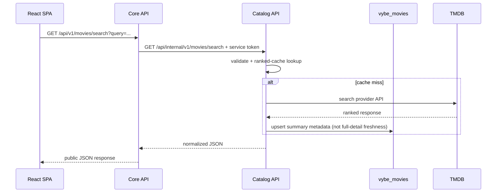

# VYBE microservices — Milestone 1 decision

**Decision:** Implement two **independently executable Laravel backends** in the same GitHub monorepo: Core API and Movie Catalog. The user approved this approach after sharing the university grading item “Effectively designs and integrates well-structured micro-services to solve complex problems.” **The precise instructor acceptance criteria remain unverified.**

| Concern | Core API | Movie Catalog |
| --- | --- | --- |
| Application | `backend/` Laravel process :8000 | `services/movie-catalog/` Laravel process :8001 |
| Domain | Identity, session, public API/BFF | Movie data, upstream TMDB integration, caching |
| Storage | `vybe_core` (users, sessions, framework tables) | `vybe_movies` (movies, framework cache/jobs) |
| API | Browser `/api/v1` using Sanctum | Internal `/api/internal/v1` using service token |
| Deploy/test | Independently start/test/deploy | Independently start/test/deploy |
| External dependencies | Catalog via HTTP | TMDB via HTTP |

## Request diagram

The internal service token authenticates a backend service, **not** a user. Do not forward Sanctum cookies to Catalog. Requests to Catalog must use private networking/TLS outside the localhost demo. Its `/api/internal/v1` endpoints must not be public in production; authorization headers alone are not a replacement for network restrictions.

### Failure handling and operational boundaries

Catalog's internal movie endpoints are implemented and reusable by any backend holding the configured shared service token. There are no per-client roles or user sessions. Core-to-Catalog forwarding and React discovery are implemented. The sequence above is the active request path; live TMDB verification still requires credentials.

Catalog uses its existing `movies` schema and framework database cache. Detail hydration is fresh for seven days; ordered popular/search snapshots expire after fifteen minutes. Concurrent detail refreshes share a cache lock and failed refreshes have a 30-second cooldown. Only previously hydrated details can be served stale; expired rankings return 503 during provider failure. Provider `Retry-After` creates a shared cooldown rather than a long worker sleep. See [Catalog operations](../../services/movie-catalog/README.md) for timeouts and configuration.

- Core handles Catalog timeout/network errors as `503 UPSTREAM_UNAVAILABLE` and logs a traceable, secret-free diagnostic. No PHP class imports across services.
- Catalog distinguishes TMDB genuine 404 from upstream outages, serves stale movie *details* when a cached copy exists, and never synthesizes TMDB ranking from arbitrary cached movies.
- Two DB schemas can run on one XAMPP server locally; databases are still separately owned, and services have no cross-DB SQL or FK relations.
- CI runs independent migrations/tests; documentation describes environment, ports, and two processes. During demo, stopping Catalog should produce a controlled public failure in Core.

### Future evolution — NOT Milestone 1

Reviews/watchlists/community may become separate services if complexity and rubric justify it. Distributed user identity and events need a separate ADR when those domains enter scope. No message broker, Kubernetes, service mesh, or dedicated gateway process now: Core already serves as the browser-facing API/BFF.

### Instructor questions still open

Minimum service count? Required independent deployment evidence? REST vs message queues? Allowed shared MySQL server with separate databases? Must services be demonstrated in Milestone 1? These answers affect grading—not whether the two Laravel apps are independently runnable.
