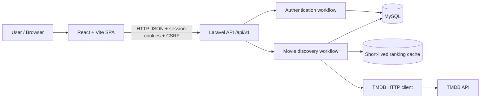

# VYBE system overview

**Status:** Overall product vision = approved/proposed mix; Milestone 1 = approved scope. No feature implementation is asserted. [Repository audit](../development/repository-audit.md).

## Product vision and boundaries

VYBE helps people discover and understand movies now, with optional social interaction in later milestones. The software has one browser SPA (React), one Laravel API runtime initially, one MySQL database, and TMDB as an upstream metadata supplier. The frontend never reads MySQL or TMDB secrets directly.

**Implemented in setup branch:** skeleton applications and CI only. **Approved but pending:** domains and endpoints drawn above, the VYBE UI, cache and schema. Drawings describe target Milestone 1, not deployed services.

## Domain map

| Domain | Responsibilities | Timeframe |
| --- | --- | --- |
| Identity | Registration, login, session, profile basics | Milestone 1 |
| Movies | TMDB retrieval, normalized detail, popular/search, metadata persistence | Milestone 1 |
| UI foundation | Shared navigation, layouts, components, responsive states | Milestone 1 |
| Watchlists, reviews, community, recommendations | Social workflows and user-generated content | Future; no code/schema now |
| Google/GitHub OAuth | External identity linking through Socialite | Future; disabled buttons now |

## Architecture principles

1. Treat Laravel as the single backend authority in Milestone 1; its controller/service/model split is application layering, **not microservice decomposition**.
2. Laravel owns authentication sessions, database writes, normalization and TMDB credentials.
3. Version the public API under `/api/v1` and map provider responses to stable VYBE representations.
4. Cache TMDB metadata persistently, separately from short-lived provider-ranked result lists.
5. Server data lives in TanStack Query; keep presentational state local and use centralized tokens.
6. Protect secrets and user data; implement honest loading, stale fallback, error and retry states.
7. Use migrations, tests and reviewed PRs for every notable change.

## Development and release boundaries

- `main`: stable, no Milestone 1 release yet.
- `dev`: integration target; as audited, scaffold setup PR #1 remains open.
- Task branches: implement independently and PR into `dev`.
- Proposed milestone promotion: verified `dev` → reviewed `main` PR → `v0.1.0` tag. No deployment is configured.

## Evolution

After Milestone 1, we may add social domains and approved OAuth. If the course explicitly requires **separately deployed** microservices earlier, resolve it before building domain features. Read [microservices evaluation](microservices.md) and [ADR 0001](../decisions/0001-initial-architecture.md).

## Open questions

- Exact instructor interpretation of WEB2/PROG303 microservices and required demonstration/deployment.
- Local XAMPP database flavor/version (MySQL vs MariaDB); compare with CI MySQL 8.0.
- Production hosting and cookie-domain topology.
- Whether release scope includes a demo deployment or only an evaluated local demonstration.
