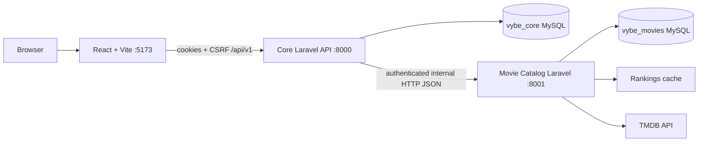

# VYBE — system architecture

**Status:** Team-approved Milestone 1 target (two independent Laravel services); not all components are implemented. The rubric rewards microservices, but the instructor has not specified a minimum topology or deployment demonstration.

## Context

- React never calls TMDB, Catalog, or MySQL directly.
- **Core API owns identity**: users, Sanctum session auth and browser-facing APIs; it adapts public movie routes to Catalog's internal contract. Core does not own movies.
- **Movie Catalog owns cinema metadata**: TMDB credential/client, normalization, movie table and separate list ranking cache. It does not know about users or browser cookies.
- Both Laravel apps may use one local XAMPP MySQL *server*, with two named databases (`vybe_core`, `vybe_movies`) and distinct credentials when possible. They remain independent applications with independent startup, migration and CI commands.
- Interservice traffic is explicit HTTP; the Catalog authenticates Core via a server-only credential. Production must also restrict service network exposure and use TLS.

## Milestone 1 feature ownership

| Domain | Owner | Public surface | Implementation status |
| --- | --- | --- | --- |
| Identity | Core API | `/api/v1/auth/*` | Planned |
| Movie discovery | Catalog API | Core forwards `/api/v1/movies/*` | Planned; catalog scaffold included in foundation starter |
| Web UI | React SPA | `/`, `/discover`, `/movies/:tmdbId`, `/login`, `/register` | Planned |
| User-generated reviews, watchlists, social feeds | Future domains | Not part of Milestone 1 | Deferred |
| Google/GitHub OAuth | Future identity integration | Disabled buttons only | Deferred |

## Technical rules

- Preserve controller → request validation → service → model/provider → API Resource where it adds value.
- Browser authorization comes from Sanctum **only at Core**. Catalog's internal token is not a user credential and does not confer user roles.
- Keep contracts explicit and versioned. No direct DB joins across `vybe_core` and `vybe_movies`.
- Normalize upstream errors; return `503` when Catalog is unavailable rather than leaking service URLs or exceptions.
- Cache full detail metadata for a configurable seven days; cache provider-ranked lists separately for a configurable short period (initially fifteen minutes).
- Independently run/test each Laravel app and the React UI. Maintain separate CI checks for Core, Catalog, frontend.

See [backend responsibilities](backend.md), [microservices](microservices.md), [two-contract API](../api/contracts.md), [schema](../database/schema.md) and [ADR 0001](../decisions/0001-initial-architecture.md).
