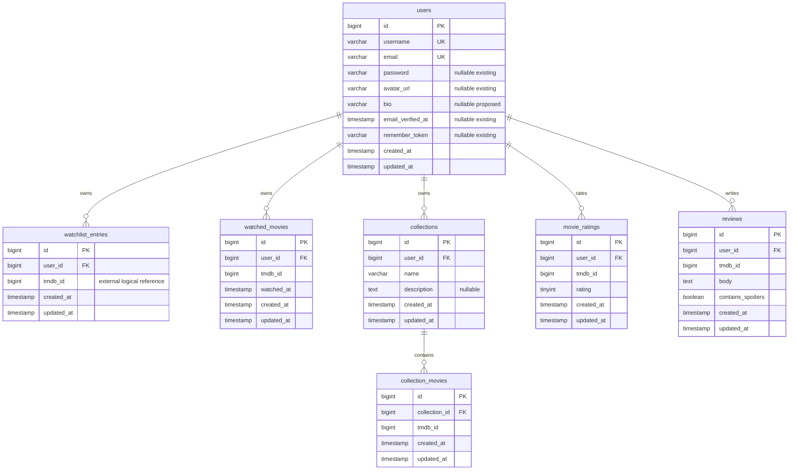

# M2 proposed Core schema

**Design only: no M2 migrations exist.** Approved entities are listed below; types, limits, indexes and conflict policies are proposed implementation details. All tables belong to Core's existing `vybe_core`. Catalog's `movies` and cache tables remain unchanged. Start with the actual [existing schema](schema.md), not a replacement users table.

## Common conventions

`id` means `BIGINT UNSIGNED NOT NULL AUTO_INCREMENT PRIMARY KEY`. Every `user_id` is `BIGINT UNSIGNED NOT NULL REFERENCES users(id) ON DELETE CASCADE`; `collection_id` similarly references `collections(id) ON DELETE CASCADE`. No cross-database keys. `tmdb_id` is `BIGINT UNSIGNED NOT NULL`, validated to 1–2147483647 to match current API limits; no default, no FK. All new non-null business fields require explicit values except stated defaults. `created_at`/`updated_at` use Laravel nullable TIMESTAMP columns, no DB default; Eloquent supplies UTC values on writes. APIs emit UTC ISO-8601 strings, dates remain `YYYY-MM-DD`.

## Existing users and proposed extension

| Column | Type, nullability, default and constraints | State |
| --- | --- | --- |
| id | BIGINT UNSIGNED NOT NULL auto PK | Existing |
| username | VARCHAR(30) NOT NULL UNIQUE, no default | Existing |
| email | VARCHAR(255) NOT NULL UNIQUE, no default | Existing |
| password | VARCHAR(255) NULL, default NULL; hash only | Existing |
| avatar_url | VARCHAR(2048) NULL, default NULL | Existing |
| email_verified_at | TIMESTAMP NULL, default NULL | Existing |
| remember_token | VARCHAR(100) NULL, default NULL | Existing |
| created_at, updated_at | TIMESTAMP NULL, default NULL | Existing |
| bio | VARCHAR(500) NULL, default NULL | Proposed addition in M2.5 |

No new profile table: one-to-one information fits users. Keep username normalization (trim/lowercase), 3–30 ASCII `[a-z0-9_]`, existing reserved names and unique index. Updates ignore the current authenticated ID when validating uniqueness; catch DB uniqueness races as 422. Email/password are not editable through profile. Member since derives from `created_at`, not another column. Nullable legacy timestamps serialize as null. Existing user FKs remain confined to Core.

## New approved entities; proposed physical definitions

| Table | All columns | Keys and additional indexes |
| --- | --- | --- |
| watchlist_entries | id; user_id; tmdb_id; created_at; updated_at | UNIQUE(user_id, tmdb_id); INDEX(user_id, created_at, id) |
| watched_movies | id; user_id; tmdb_id; watched_at TIMESTAMP NOT NULL (no DB default); created_at; updated_at | UNIQUE(user_id, tmdb_id); INDEX(user_id, watched_at, id) |
| collections | id; user_id; name VARCHAR(100) NOT NULL; description TEXT NULL DEFAULT NULL; created_at; updated_at | UNIQUE(user_id, name); INDEX(user_id, created_at, id) |
| collection_movies | id; collection_id; tmdb_id; created_at; updated_at | UNIQUE(collection_id, tmdb_id); INDEX(collection_id, created_at, id) |
| movie_ratings | id; user_id; tmdb_id; rating TINYINT UNSIGNED NOT NULL; created_at; updated_at | UNIQUE(user_id, tmdb_id); INDEX(tmdb_id, rating); CHECK(rating BETWEEN 1 AND 5) |
| reviews | id; user_id; tmdb_id; body TEXT NOT NULL; contains_spoilers BOOLEAN NOT NULL DEFAULT FALSE; created_at; updated_at | UNIQUE(user_id, tmdb_id); INDEX(tmdb_id, created_at, id) |

All unnamed column definitions and foreign keys inherit the explicit common conventions above. `collection_movies` has no redundant `user_id`: ownership follows collection → user. No FK or uniqueness relationship links reviews to ratings. BOOLEAN maps to MySQL TINYINT(1); validate strict booleans at the JSON boundary. Verify CHECK enforcement on the target engine in M2.3; retain FormRequest validation regardless.

## Relationships

Catalog is deliberately outside this relational ERD: `tmdb_id` is a logical HTTP reference, never a relationship that Eloquent joins across databases. Users can have zero to many rows in each feature; collections can have zero to many movies. A movie can appear in many users' lists and in many collections, with at most one occurrence per respective owner/container.

## Integrity and query decisions

- Use a surrogate `collection_movies.id` for ordinary Eloquent identity and deterministic pagination; composite unique key enforces membership. A composite primary key saves a column but complicates standard Eloquent operations, so is not selected.
- Collection names: trim outer whitespace, preserve display case, reject blank, max 100 characters. Proposed explicit `utf8mb4_unicode_ci` collation on `name`, making owner-local uniqueness case- and accent-insensitive (`Favorites`/`favorites` conflict). Do not rely on deployment default collation or an application-only check. Internal whitespace remains significant. Confirm this user-visible accent policy with the team before M2.2.
- Description nullable, max 2000 characters; normalize blank to null. Bio nullable, max 500. Review trim then 1–5000 characters, plain text. Rating must be a JSON integer 1–5; spoiler flag JSON boolean. All IDs are positive integers within the current API range.
- `watched_at` is the first mark time, server UTC; repeated POST returns the same row without changing it or `updated_at`. Remove then add records a new watch time. Rewatch history/backdating are deferred. Watchlist and Watched may coexist.
- Lists order watchlist/collection membership by created_at DESC, id DESC; watched by watched_at DESC, id DESC; collections by created_at DESC, id DESC. Reviews order created_at DESC, id DESC, never move on edit. Offset pagination can shift under concurrent writes; no snapshot guarantee.
- Movie rating aggregates use one grouped query on `(tmdb_id, rating)`; fill zero buckets 1–5, derive count/weighted average. No persistent counters/materialized aggregates or TMDB-score mixing. Upserts replace the current value; aggregates reflect committed values on next read. No cache invalidation infrastructure initially.
- Profile counts use three owner-scoped COUNT queries (watchlist, watched, reviews) or equivalent subqueries; owner-leading unique indexes support them. Collection counts use `withCount`, not per-row queries. Reviews eager-load only the public author projection, never email. Library pages use one bounded Catalog batch, not an ORM relationship to movies.
- Unique keys are the concurrency authority. Add-if-absent operations must preserve existing timestamps (insert with uniqueness handling then select); rating PUT uses atomic upsert and stable 200 semantics. Review conflicts return 409; name/username conflicts 422. Do not use check-then-insert alone or broad `insertOrIgnore` that can hide unrelated data errors.
- Deleting users cascades all their direct records, then collection memberships via collection cascade. No Catalog deletions, cross-service cascades or orphaned collection memberships. No soft deletes in M2. Empty collections are ordinary collection rows with zero children.

## Deferred work

Each slice owns its additive migration, down-migration policy, Eloquent relationships, constraints and isolated MySQL tests. No new DB or production migration step is needed in M2.0. Review collation, unresolved-reference writes and avatar storage before their slices; retain no speculative social/moderation columns.
