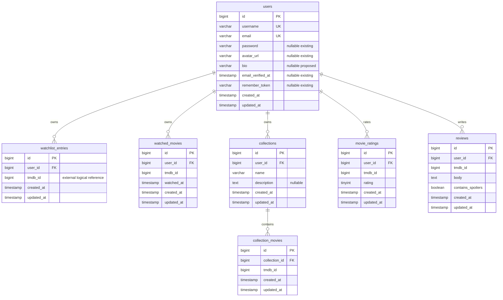

# M2 Core schema — M2.1–M2.4 implemented; profile extension proposed

**M2.1 library, M2.2 collections, M2.3 movie_ratings and M2.4 reviews are implemented.** Bio remains design-only for M2.5. Core migrations: `2026_10_31_000001_create_watchlist_entries_table.php`, `2026_10_31_000002_create_watched_movies_table.php`, `2026_11_01_000001_create_collections_table.php`, `2026_11_01_000002_create_collection_movies_table.php`, `2026_11_03_000001_create_movie_ratings_table.php`, `2026_11_03_000002_create_reviews_table.php`. Each rollback drops only its own table, memberships before collections; roll back only on a disposable database or after a separate data-retention decision. All tables belong to Core's existing `vybe_core`. Catalog's `movies` and cache tables remain unchanged. Start with the actual [existing schema](schema.md), not a replacement users table.

M2.3 uses BIGINT UNSIGNED IDs, TINYINT UNSIGNED rating, cascade user FK, UNIQUE(user_id, tmdb_id), INDEX(tmdb_id, rating), and named CHECK constraints for rating 1–5 and TMDB ID 1–2147483647 on MySQL. MySQL 8.0.16+ CHECK enforcement is required; verified on 8.0.43. SQLite declares checks/FK with CREATE TABLE, then the same two indexes; it additionally checks the stored rating's integer type. Both engines passed range/unique/cascade tests and migration rollback/reapply. MariaDB was not run for this slice; validate CHECK enforcement on a deployment using it. Strict JSON integer validation is enforced separately from database numeric coercion. No Catalog, review or library FK exists. User::movieRatings() and MovieRating::user() implement the relationship; the fillable allowlist is tmdb_id/rating, with ownership supplied by the session/service.

## Common conventions

`id` means `BIGINT UNSIGNED NOT NULL AUTO_INCREMENT PRIMARY KEY`. Every `user_id` is `BIGINT UNSIGNED NOT NULL REFERENCES users(id) ON DELETE CASCADE`; `collection_id` similarly references `collections(id) ON DELETE CASCADE`. No cross-database keys. `tmdb_id` is `BIGINT UNSIGNED NOT NULL`, validated to 1–2147483647 to match current API limits; no default, no FK. All new non-null business fields require explicit values except stated defaults. `created_at`/`updated_at` use Laravel nullable TIMESTAMP columns, no DB default; Eloquent supplies UTC values on writes. APIs emit UTC ISO-8601 strings, dates remain `YYYY-MM-DD`.

## Existing users and proposed extension

| Column | Type, nullability, default and constraints | State |
| --- | --- | --- |
| id | BIGINT UNSIGNED NOT NULL auto PK | Existing |
| username | VARCHAR(30) NOT NULL UNIQUE, no default | Existing |
| email | VARCHAR(255) NOT NULL UNIQUE, no default | Existing |
| password | VARCHAR(255) NULL, default NULL; hash only | Existing |
| avatar_url | VARCHAR(2048) NULL, default NULL | Existing |
| email_verified_at | TIMESTAMP NULL, default NULL | Existing |
| remember_token | VARCHAR(100) NULL, default NULL | Existing |
| created_at, updated_at | TIMESTAMP NULL, default NULL | Existing |
| bio | VARCHAR(500) NULL, default NULL | Proposed addition in M2.5 |

No new profile table: one-to-one information fits users. Keep username normalization (trim/lowercase), 3–30 ASCII `[a-z0-9_]`, existing reserved names and unique index. Updates ignore the current authenticated ID when validating uniqueness; catch DB uniqueness races as 422. Email/password are not editable through profile. Member since derives from `created_at`, not another column. Nullable legacy timestamps serialize as null. Existing user FKs remain confined to Core.

## Implemented M2 tables

| Table | All columns | Keys and additional indexes |
| --- | --- | --- |
| watchlist_entries | id; user_id; tmdb_id; created_at; updated_at | UNIQUE(user_id, tmdb_id); INDEX(user_id, created_at, id) |
| watched_movies | id; user_id; tmdb_id; watched_at TIMESTAMP NOT NULL (no DB default); created_at; updated_at | UNIQUE(user_id, tmdb_id); INDEX(user_id, watched_at, id) |
| collections | id; user_id; name VARCHAR(100) NOT NULL; description TEXT NULL DEFAULT NULL; created_at; updated_at | INDEX(user_id, created_at, id) |
| collection_movies | id; collection_id; tmdb_id; created_at; updated_at | UNIQUE(collection_id, tmdb_id); INDEX(collection_id, created_at, id) |
| movie_ratings | id; user_id; tmdb_id; rating TINYINT UNSIGNED NOT NULL; created_at; updated_at | UNIQUE(user_id, tmdb_id); INDEX(tmdb_id, rating); CHECK(rating BETWEEN 1 AND 5) |
| reviews | id; user_id; tmdb_id; body TEXT NOT NULL; contains_spoilers BOOLEAN NOT NULL DEFAULT FALSE; created_at; updated_at | UNIQUE(user_id, tmdb_id); INDEX(tmdb_id, created_at, id) |

All unnamed column definitions and foreign keys inherit the explicit common conventions above. `collection_movies` has no redundant `user_id`: ownership follows collection → user. No FK or uniqueness relationship links reviews to ratings. BOOLEAN maps to MySQL TINYINT(1); validate strict booleans at the JSON boundary. Verify CHECK enforcement on the target engine in M2.3; retain FormRequest validation regardless.

## Relationships

Catalog is deliberately outside this relational ERD: `tmdb_id` is a logical HTTP reference, never a relationship that Eloquent joins across databases. Users can have zero to many rows in each feature; collections can have zero to many movies. A movie can appear in many users' lists and in many collections, with at most one occurrence per respective owner/container.

## Integrity and query decisions

- Use a surrogate `collection_movies.id` for ordinary Eloquent identity and deterministic pagination; composite unique key enforces membership. A composite primary key saves a column but complicates standard Eloquent operations, so is not selected.
- Implemented M2.2 collection names: trim outer whitespace, preserve user-entered capitalization, reject blank, max 100 characters. Duplicate names (including exact matches, `Favorites`, `favorites`, `FAVORITES`) are allowed within an owner. IDs define identity; no owner/name unique key or case-folded identity. `Collection` belongs to User and has many `CollectionMovie` rows; User has many collections. Explicit fillable lists exclude owner/container IDs, which come from relationships.
- Description nullable, max 2000 characters; normalize blank to null. Bio nullable, max 500. Review trim then 1–5000 characters, plain text. Rating must be a JSON integer 1–5; spoiler flag JSON boolean. All IDs are positive integers within the current API range.
- `watched_at` is the first mark time, server UTC; repeated POST returns the same row without changing it or `updated_at`. Remove then add records a new watch time. Rewatch history/backdating are deferred. Watchlist and Watched may coexist.
- Lists order watchlist/collection membership by created_at DESC, id DESC; watched by watched_at DESC, id DESC; collections by created_at DESC, id DESC. Reviews order created_at DESC, id DESC, never move on edit. Offset pagination can shift under concurrent writes; no snapshot guarantee.
- Movie rating aggregates use one grouped query on `(tmdb_id, rating)`; fill zero buckets 1–5, derive count/weighted average. No persistent counters/materialized aggregates or TMDB-score mixing. Upserts replace the current value; aggregates reflect committed values on next read. No cache invalidation infrastructure initially.
- Profile counts use three owner-scoped COUNT queries (watchlist, watched, reviews) or equivalent subqueries; owner-leading unique indexes support them. Collection counts use `withCount`, not per-row queries. Reviews eager-load only the public author projection, never email. Library pages use one bounded Catalog batch, not an ORM relationship to movies.
- Unique keys are the concurrency authority. Add-if-absent operations must preserve existing timestamps (insert with uniqueness handling then select); rating PUT uses atomic upsert and stable 200 semantics. Review conflicts return 409; username conflicts 422. Collection names do not conflict. Do not use check-then-insert alone or broad `insertOrIgnore` that can hide unrelated data errors.
- Deleting users cascades all their direct records, then collection memberships via collection cascade. No Catalog deletions, cross-service cascades or orphaned collection memberships. No soft deletes in M2. Empty collections are ordinary collection rows with zero children.

M2.2 addition confirms the Catalog reference before taking a short Core transaction. It then re-resolves the owner-scoped collection with `lockForUpdate` and calls `firstOrCreate`; the membership unique index remains authoritative. A deletion during confirmation returns 404; the locked parent prevents a deletion between the final check and insert. Updates and removals also lock the owned parent. No network call runs while holding the lock. Counts use `withCount`; optional membership annotation uses an indexed `withExists` projection. See [M2.2 verification](../development/m2.2-report.md).

## Deferred work

Each slice owns its additive migration, down-migration policy, Eloquent relationships, constraints and isolated MySQL tests. No new DB or production migration step is needed in M2.0. M2.1 validates new references through Catalog; M2.4 uses the same reference confirmation for new reviews only; review avatar storage in M2.5; retain no speculative social/moderation columns.

## M2.4 implementation details

`Review` belongs to User; `User::reviews()` owns the relationship. Its explicit fillable list is tmdb_id/body/contains_spoilers; user_id always comes from the authenticated relationship. The Core migration `2026_11_03_000002_create_reviews_table.php` creates the reviews row defined above, cascade user FK, unique `(user_id, tmdb_id)` and ordered-list index `(tmdb_id, created_at, id)`. There is no relationship to movie_ratings, library memberships or Catalog tables. Deleting a review affects none of them. User deletion cascades reviews.

Body validation trims Unicode edge whitespace and accepts 1–5000 Unicode code points; TEXT with the existing utf8mb4 connection holds this bounded content. Stored text is not interpreted as markup. JSON boolean validation is strict; the database default and service creation default are false. Laravel timestamps retain existing precision and UTC serialization; no history/version column is added. Edits preserve id/created_at and do not reorder the list.

Duplicate checks precede Catalog confirmation, but the unique key is authoritative for races. A uniqueness exception maps to 409 REVIEW_EXISTS, never replacement. PATCH/DELETE lock only the owner/movie/id row in a short Core transaction; no network call occurs under a lock. The nonempty public list executes count, page and eager author queries (three total), with only public author columns. Empty pages do not perform an author query or Catalog request. SQLite and isolated MySQL tests verify constraints/cascades and rollback/reapply; two concurrent MySQL workers produced one row and 201/409. See the [M2.4 report](../development/m2.4-report.md).
