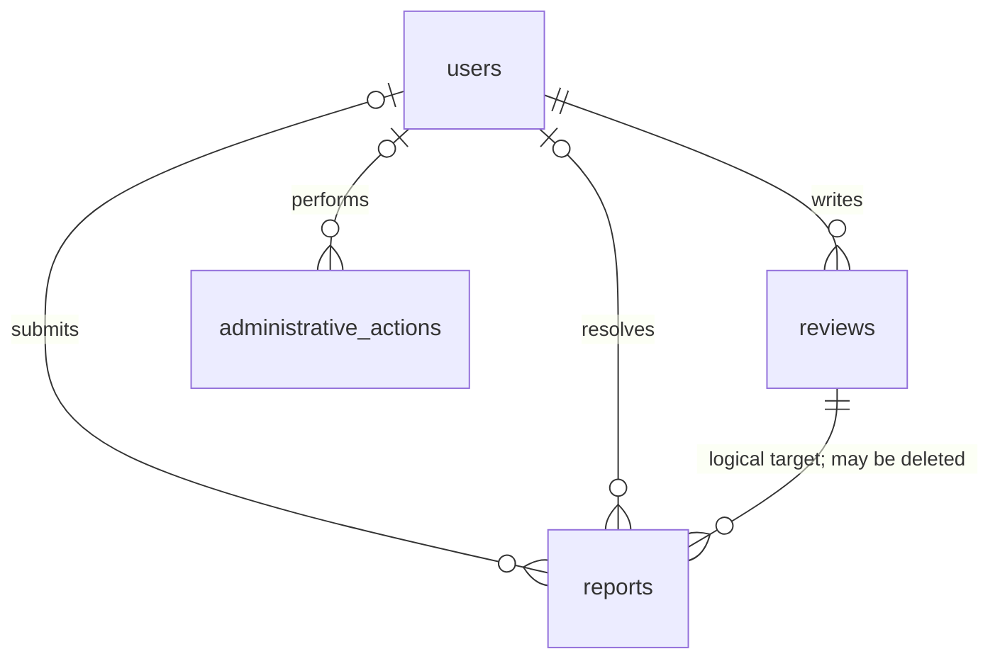

# M3 database design — proposed

No M3 migrations exist. This design extends the implemented [M2 schema](milestone-2-schema.md) in Core's existing database; Catalog owns only movie metadata. IDs below are unsigned BIGINT auto-increment primary keys unless stated. Timestamps follow existing nullable Laravel UTC timestamps. APIs validate string/enum bounds; add portable CHECK constraints where supported and verify enforcement on the actual MySQL and SQLite test engines. No client can mass-assign owner, actor, state, or timestamps.

## Existing structures

`users` already has unique normalized email and username, nullable password, avatar reference, nullable verification timestamp and bio. `reviews` has `user_id` cascade FK, `tmdb_id`, `body`, author-controlled boolean `contains_spoilers`, timestamps, unique `(user_id, tmdb_id)` and `(tmdb_id, created_at, id)` index. `movie_ratings` has unique `(user_id, tmdb_id)`, 1–5 check and `(tmdb_id, rating)` index. Watchlist, watched and collections have their owner keys, timestamps and uniqueness described in M2. `sessions.user_id` is indexed but is not a foreign key. `password_reset_tokens` already exists. Existing user deletion cascades the M2 relationships; it does not remove Catalog movies.

## Proposed Core changes

| Table / column | Type, default, relationship and validation |
| --- | --- |
| `users.role` | `VARCHAR(16) NOT NULL DEFAULT 'user'`; allow `user`, `moderator`, `admin`; only trusted bootstrap can assign admin; API assigns only user/moderator. Existing rows backfill `user`. |
| `users.account_status` | `VARCHAR(16) NOT NULL DEFAULT 'active'`; allow `active`, `restricted`, `banned`, `deactivated`; existing rows backfill active. No separate ban/restriction booleans. |
| `users.invitation_pending` | `BOOLEAN NOT NULL DEFAULT false`, M3.1; set only for admin-created invitees and clear atomically when the setup token is consumed. This prevents an ordinary unverified registration from using the invitation flow. Existing rows backfill false; never expose or mass-assign it. |
| `users.recommendation_revision` | `BIGINT UNSIGNED NOT NULL DEFAULT 0`, M3.3; increment atomically in the same transaction as every successful rating, watchlist, watched or collection-membership change, including membership loss from collection deletion. It is server-managed, not a public user field. It prevents a computation begun before a write from installing an obsolete cache entry. |
| `reviews.visibility` | `VARCHAR(16) NOT NULL DEFAULT 'visible'`; `visible`/`hidden`; backfill visible. Moderator action only. |
| `reviews.moderator_spoiler` | `BOOLEAN NOT NULL DEFAULT false`; moderator action only. Existing `contains_spoilers` remains the author flag. Public effective flag is their OR. |

Add `INDEX(account_status, role, id)` for active-admin locking and status listing; existing unique indexes support exact username/email searches. Initial user search should use indexed exact email/username or username prefix and stable `id` order; arbitrary contains search needs a measured indexing decision. Add `INDEX(reviews.tmdb_id, visibility, created_at, id)` for public page/count and `INDEX(reviews.visibility, created_at, id)` for moderation queue. Preserve existing uniqueness and author ownership. Test pagination query plans on target DB before removing any existing index.

## `reports` — Core, M3.2

| Column | Definition |
| --- | --- |
| `id` | PK. |
| `reporter_id` | `BIGINT UNSIGNED NULL`, FK `users(id) ON DELETE SET NULL`; non-null at creation, nullable only after account deletion. |
| `target_type` | `VARCHAR(24) NOT NULL`; allowlisted `review` only in M3. No arbitrary PHP class names. |
| `target_id` | `BIGINT UNSIGNED NOT NULL`; positive review ID. Logical reference, deliberately no polymorphic FK; see deletion rules below. |
| `reason` | `VARCHAR(32) NOT NULL`; one of `harassment`, `hate`, `spam`, `spoiler`, `other`. |
| `description` | `VARCHAR(1000) NULL DEFAULT NULL`; trimmed plain text, max 1000 Unicode characters, blank becomes null. |
| `status` | `VARCHAR(16) NOT NULL DEFAULT 'pending'`; `pending`, `resolved`, `dismissed`. |
| `resolved_by` | `BIGINT UNSIGNED NULL`, FK `users(id) ON DELETE SET NULL`; set by server on transition. |
| `resolved_at` | `TIMESTAMP NULL DEFAULT NULL`; server UTC, set on transition. |
| `resolution_note` | `VARCHAR(1000) NULL DEFAULT NULL`; plain text, required for dismissal and resolution. |
| `resolution_action` | `VARCHAR(24) NULL DEFAULT NULL`; server-set `hide` or `mark_spoiler` on resolution; null while pending or dismissed. Supports deterministic replay even if the review is later deleted. |
| `created_at`, `updated_at` | Laravel timestamps. |

Unique `(reporter_id, target_type, target_id)` guarantees one report per existing reporter/target, including concurrent submissions; nullable reporter after deletion deliberately permits multiple historical nulls. Index `(status, created_at, id)` for the queue and `(target_type, target_id, status)` for target investigation. Target type/id references are deliberately logical so later allowlisted target kinds can be added without accepting arbitrary models. The M3.2 service locks and verifies a visible review before insert; author delete uses the same review row lock. A deleted review leaves the report's target ID, but no content snapshot; the queue marks it unavailable and permits dismissal. This preserves action context without retaining deleted review text. Reports by a deleted user are retained with a null reporter; resolved actor may also become null. Review deletion does not cascade reports.

## `administrative_actions` — Core, M3.1 then M3.2

| Column | Definition |
| --- | --- |
| `id` | PK. |
| `actor_id` | `BIGINT UNSIGNED NULL`, FK `users(id) ON DELETE SET NULL`; non-null when written. |
| `action` | `VARCHAR(48) NOT NULL`; server allowlist such as `user.role_changed`, `user.status_changed`, `user.created`, `user.updated`, `user.deleted`, `review.hidden`, `review.restored`, `review.spoiler_set`, `report.resolved`, `report.dismissed`. |
| `target_type` | `VARCHAR(24) NOT NULL`; server allowlist `user`, `review`, `report`. |
| `target_id` | `BIGINT UNSIGNED NOT NULL`; logical target ID; deliberately no FK so deletion does not erase history. |
| `reason` | `VARCHAR(1000) NULL DEFAULT NULL`; bounded plain text, required for destructive/status decisions as specified by API. |
| `details` | `JSON NULL DEFAULT NULL`; server-generated allowlisted non-sensitive transitions only, e.g. old/new role or status. Never store body, email, password, session, token or request payload. |
| `created_at` | `TIMESTAMP NOT NULL`, server-generated; append-only; no `updated_at`. |

Indexes `(target_type, target_id, created_at, id)` and `(actor_id, created_at, id)`. Actions and corresponding state changes commit in the same transaction; failed/no-op operations produce no misleading action. Action log is not event sourcing. Access is privileged and private. Define and approve an actual retention period before deployment; a null actor/ID after account deletion is not a full anonymization guarantee.

## Relationships and deletion

Admin deactivation preserves identity and all content, denies authenticated access, and can be restored. Public reviews and aggregate ratings remain visible during restriction, ban, or deactivation until a separate review moderation decision or hard deletion; do not silently treat a ban as content moderation. Admin hard deletion is a separate confirmed action: delete the user and current M2 cascades remove reviews, ratings, libraries and collections; cleanup of exact managed avatar path is best effort, recorded without secrets. Report and action FK references null out as above; logical target IDs remain. Cached immutable public avatar copies cannot be recalled. Protect the last active admin and prohibit self-delete. There is no Catalog FK or cross-service delete. Sign off the data-retention policy before exposing hard delete in production.

M3.3 needs no new recommendation table. Catalog's existing `movies.genres` is nullable detail metadata; popular summaries do not carry genre IDs and credits are cached separately. The proposed internal candidate endpoint may extend Catalog normalization and cache entries for list genre IDs and writer credits; it must not pretend those fields exist today. Any future Catalog migration or cache format/version change is owned and tested in M3.3, separately from Core. Rollback plans and isolated SQLite/MySQL cascade, uniqueness, check, race and migration tests belong to each implementation slice.
