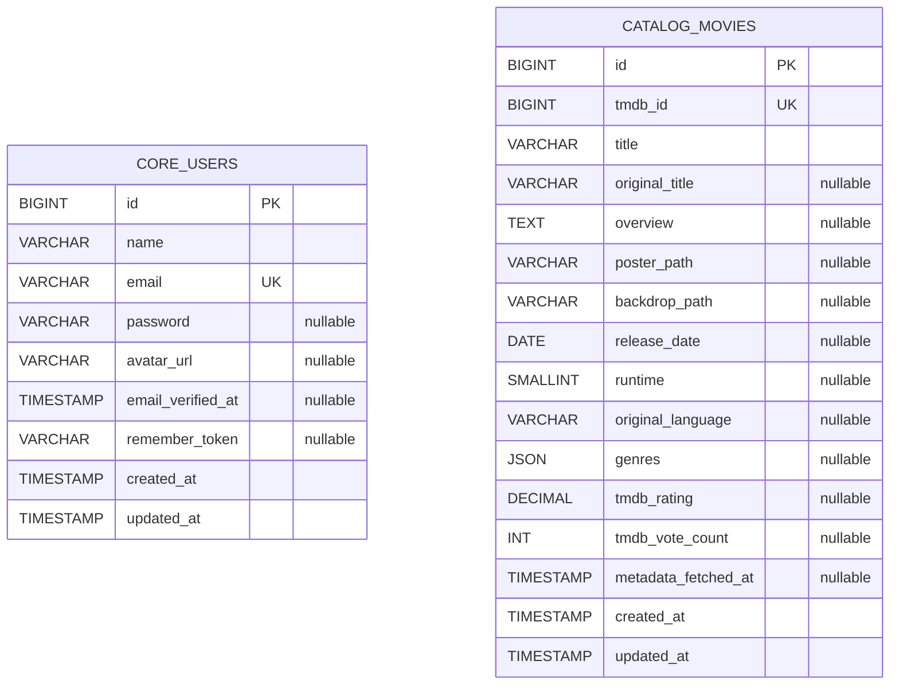

# Milestone 1 database schema and ownership

**Status:** Approved schema. The starter package supplies the **Catalog movies migration**; Core's users schema adjustments are a separate implementation task. The two Laravel apps must never query each other's database.

## Core — `vybe_core.users`

| Column | Type / constraint |
| --- | --- |
| `id` | BIGINT unsigned, PK, auto-increment |
| `name` | VARCHAR(100) NOT NULL |
| `email` | VARCHAR(255) NOT NULL UNIQUE; normalize for registration/login |
| `password` | VARCHAR(255) NULL; hashes only; required in email/password registration |
| `avatar_url` | VARCHAR(2048) NULL |
| `email_verified_at` | TIMESTAMP NULL |
| `remember_token` | VARCHAR(100) NULL; never expose |
| `created_at`, `updated_at` | TIMESTAMP |

Keep standard Laravel sessions, password-reset, cache and jobs tables as actually needed by Core. Social accounts, reviews and watchlists are deferred. Never duplicate a `users` table inside Catalog.

## Catalog — `vybe_movies.movies`

| Column | Type / constraint |
| --- | --- |
| `id` | BIGINT unsigned, PK, auto-increment |
| `tmdb_id` | BIGINT unsigned, NOT NULL UNIQUE |
| `title` | VARCHAR(255) NOT NULL |
| `original_title` | VARCHAR(255) NULL |
| `overview` | TEXT NULL |
| `poster_path`, `backdrop_path` | VARCHAR(255) NULL, TMDB-relative paths |
| `release_date` | DATE NULL |
| `runtime` | SMALLINT unsigned NULL (minutes) |
| `original_language` | VARCHAR(10) NULL |
| `genres` | JSON NULL; array of `{id, name}` objects |
| `tmdb_rating` | DECIMAL(4,2) NULL (0–10 provider range) |
| `tmdb_vote_count` | INT unsigned NULL |
| `metadata_fetched_at` | TIMESTAMP NULL; only for *full detail hydration* |
| `created_at`, `updated_at` | TIMESTAMP |

The Catalog owns its framework `cache` and `jobs` tables. Its migration **must not** include the Laravel starter `users` or `password_reset_tokens` tables. Session driver can be `file` or `array` because Catalog does not authenticate browsers.

## Persistence invariants

- `tmdb_id` is the stable **external movie identifier** in all public and internal movie URLs. The DB auto-increment `id` is internal to Catalog.
- List summary updates may add fields but must not set `metadata_fetched_at`, overwrite known runtime/genres, or null out previously hydrated detail when upstream omits fields.
- Refresh full-detail only when missing/stale (7-day configurable TTL); keep provider-ordered lists in separate short-lived cache (15-minute default), keyed by page and normalized search query.
- MySQL unique constraints, not in-process existence checks, enforce duplicate prevention. Migrate each DB independently and test both on disposable MySQL instances.
- Local XAMPP may use MariaDB, whose JSON handling may differ from MySQL 8; test the exact target engine before release.

## Future cross-service associations

Future review/watchlist records may reference user ID and TMDB ID as logical external identifiers. There are no cross-database foreign keys in Milestone 1; cross-service integrity needs a future contract decision.
