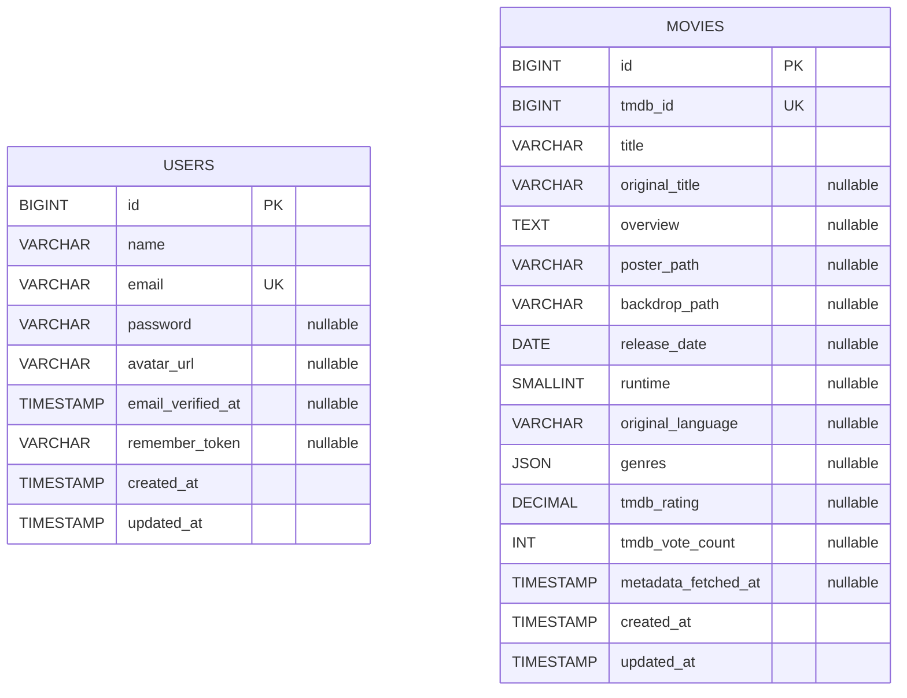

# MySQL schema — Milestone 1

**Status:** Approved design, **not yet migrated** as of setup branch audit. Default Laravel migration does **not** match the target `users` table and no `movies` table exists yet. Review migration strategy before a shared database is used.

## Entity diagram

No FK between `users` and `movies` during Milestone 1. `social_accounts`, `reviews`, `watchlists`, etc. are intentionally deferred.

## `users`

| Column | MySQL type | Rules |
| --- | --- | --- |
| `id` | BIGINT UNSIGNED | Primary key, auto-increment |
| `name` | VARCHAR(100) | Required |
| `email` | VARCHAR(255) | Required, unique, normalized for login/uniqueness rules |
| `password` | VARCHAR(255) | Nullable for future OAuth-only accounts; hashed if set |
| `avatar_url` | VARCHAR(2048) | Nullable; validate before accepting remote URLs |
| `email_verified_at` | TIMESTAMP | Nullable |
| `remember_token` | VARCHAR(100) | Nullable; framework token; never expose |
| `created_at`, `updated_at` | TIMESTAMP | Laravel timestamps |

**Security note:** Email/password registration requires a password even though the persistence column is nullable. Authentication fails cleanly for accounts with `NULL` password. Verification status is separate from successful registration; no email delivery feature is assumed. Do not leak hashes or tokens in user resources.

## `movies`

| Column | MySQL type | Rules |
| --- | --- | --- |
| `id` | BIGINT UNSIGNED | Primary key, auto-increment |
| `tmdb_id` | BIGINT UNSIGNED | Required, unique, positive TMDB movie ID |
| `title` | VARCHAR(255) | Required |
| `original_title` | VARCHAR(255) | Nullable |
| `overview` | TEXT | Nullable |
| `poster_path` | VARCHAR(255) | Nullable; provider-relative path |
| `backdrop_path` | VARCHAR(255) | Nullable; provider-relative path |
| `release_date` | DATE | Nullable; invalid/unknown upstream dates -> NULL |
| `runtime` | SMALLINT UNSIGNED | Nullable, minutes; validate numeric range |
| `original_language` | VARCHAR(10) | Nullable; provider language code |
| `genres` | JSON | Nullable; consistent normalized array objects (proposal: `{id, name}`) |
| `tmdb_rating` | DECIMAL(4,2) | Nullable, from 0.00 to 10.00 |
| `tmdb_vote_count` | INT UNSIGNED | Nullable |
| `metadata_fetched_at` | TIMESTAMP | Nullable; set only after detail hydration succeeds |
| `created_at`, `updated_at` | TIMESTAMP | Laravel timestamps |

Constraint defaults: unique index `movies_tmdb_id_unique`; `users_email_unique`. No extra indexes until real queries justify them. Use utf8mb4. MySQL and MariaDB may differ in JSON implementation; test against the actual XAMPP engine.

### Summary vs detail hydration

TMDB popular/search typically return **summary items** that omit runtime and other detail-only fields. When upserting summaries, update only fields actually supplied and **do not set `metadata_fetched_at`** as if detail were fetched. Detail endpoint may refresh full metadata when no record exists or metadata is stale (default TTL seven days, config-driven). Missing/null upstream fields must not silently wipe known detail on a summary upsert.

### Data ownership and consistency

- Movie lookup always keyed externally by `tmdb_id`, not internal auto-increment `id`.
- Use a database-level unique constraint and atomic `upsert`/appropriate safe retry under parallel requests.
- Movie results cached persistently in `movies`; TMDB ordering is separately cached in Laravel Cache, not inferred by sorting the `movies` table.
- Stale metadata may be served on upstream failure, with explicit contract metadata/telemetry.
- No extra `popular_movies` table is needed for the first version; the ranked-ID cache can use Laravel's cache store with short TTL.

## Laravel framework tables

Existing framework migrations may include `sessions`, `password_reset_tokens`, `cache`, `jobs`, failed jobs and personal access tokens if Sanctum creates them. They are infrastructure, not social-domain models. Only provision tables actually required by configured drivers.

## Migration policy

- Inspect scaffold migrations. If their schema has already been used by teammates, **add a new migration** instead of editing an applied migration; if it is still purely an unshared scaffold and everyone agrees, changing the original migration is possible but document why.
- Migration PRs must contain reproducible forward changes and database tests; never reset a shared DB to make migrations pass.
- CI migration step uses MySQL 8.0, but `phpunit.xml` in setup branch defaults to in-memory SQLite for Laravel tests. Test coverage is not automatically MySQL-backed.
- Use a dedicated disposable `vybe_test` database for destructive test commands, never production or shared development data.

## Future schema (NO migration)

A future `social_accounts` table may have `id`, `user_id` FK, `provider`, `provider_user_id`, timestamps, and `UNIQUE(provider,provider_user_id)`. Linking/uniqueness and verified-email rules need an ADR when OAuth is actually scoped. Do not create this table now.
